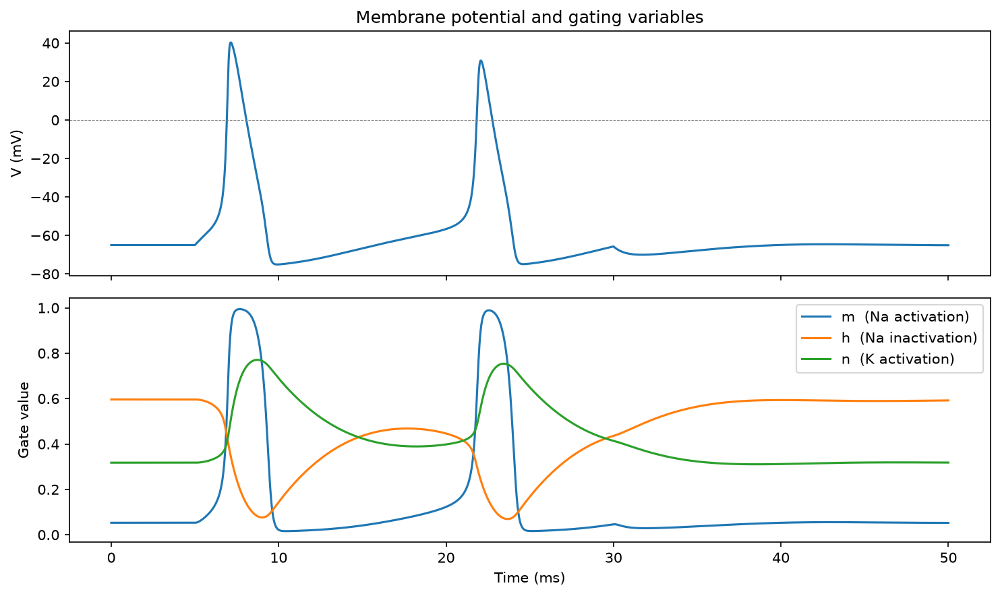

# Hodgkin-Huxley neuron model

A from-scratch implementation of the Hodgkin-Huxley (HH) model of the neuronal
action potential, built with NumPy, SciPy, and Matplotlib. The model reproduces
the action potential of the squid giant axon directly from the underlying
ion-channel dynamics, and visualises how the sodium and potassium gating
variables generate the spike.

This is the mechanism layer of a summer portfolio in computational neuroscience
and bioelectricity: where a signal-classification project reads population-level
bioelectric activity, this project explains what physically produces that
activity, from the ion channel up.

## The model

HH treats a patch of membrane as an electrical circuit: a capacitor (the lipid
bilayer) in parallel with three ionic conductances - sodium, potassium, and a
passive leak - each in series with its reversal (Nernst) potential. The membrane
potential evolves according to C_m dV/dt = I_ext - g_Nam^3h*(V - E_Na) - g_Kn^4(V - E_K) - g_L*(V - E_L)

The sodium and potassium conductances are voltage- and time-dependent,
controlled by three gating variables:

- `m` - sodium activation (fast)
- `h` - sodium inactivation (slow)
- `n` - potassium activation (slow)

Each gate follows first-order kinetics, `dx/dt = alpha(V)(1 - x) - beta(V)x`,
with the six voltage-dependent rate functions taken from the original 1952
formulation using standard squid-axon parameters.

## What's implemented

- The six rate functions and the full four-variable ODE system (V, m, h, n)
- Numerical integration with `scipy.integrate.solve_ivp` (RK45)
- A resting-state sanity check: a neuron with no input stays at rest
- A two-panel figure - membrane potential over time, with the three gating
  variables aligned beneath it

## Running it

pip install -r requirements.txt
python hh.py

This prints the resting-state check, opens the figure, and saves it to
`figures/gating_dynamics.png`.

## Results

A sustained 10 uA/cm^2 current step (5-30 ms) produces a short train of action
potentials with all the expected features:

- A sharp, all-or-none upstroke to roughly +40 mV
- Fast repolarisation followed by an afterhyperpolarisation dip below rest
  (around -75 mV)
- Repetitive firing while the current is sustained

The gating panel shows the mechanism directly: `m` opens almost instantly to
drive the upstroke, `h` collapses a beat later to shut off the sodium current
and terminate the spike, and `n` rises slowly and stays elevated to repolarise
the cell. The second spike peaks lower than the first (around +31 mV) because
the slow inactivation gate `h` has not fully recovered before the cell fires
again - spike-amplitude accommodation, which emerges from the dynamics rather
than being built in.

## Limitations

- Single-compartment and isopotential: no spatial extent, so it cannot produce
  a *propagating* action potential (the planned extension - see below).
- Uses the original squid-axon parameters at the original temperature; not tuned
  to mammalian neurons or body temperature.
- No synaptic input, channel noise, or additional ion-channel types.
- Validation is qualitative: reproduces the known behaviour of the HH system but
  is not quantitatively benchmarked against a reference implementation.

## Planned extension (v2)

The natural next step - and the reason HH was originally formulated - is spatial
propagation. Coupling many HH compartments through a diffusion term (the method
of lines) turns the single spike into a travelling wave down a 1D cable: a
propagating action potential. A 2D excitable sheet, showing wavefronts and
spiral waves, is a further reach toward bioelectric pattern formation.

Two smaller validation figures are also planned before v2 is complete: the
all-or-none firing threshold, and the frequency-current (F-I) curve.

## Reference

Hodgkin, A. L., & Huxley, A. F. (1952). A quantitative description of membrane
current and its application to conduction and excitation in nerve. The Journal
of Physiology, 117(4), 500-544.
